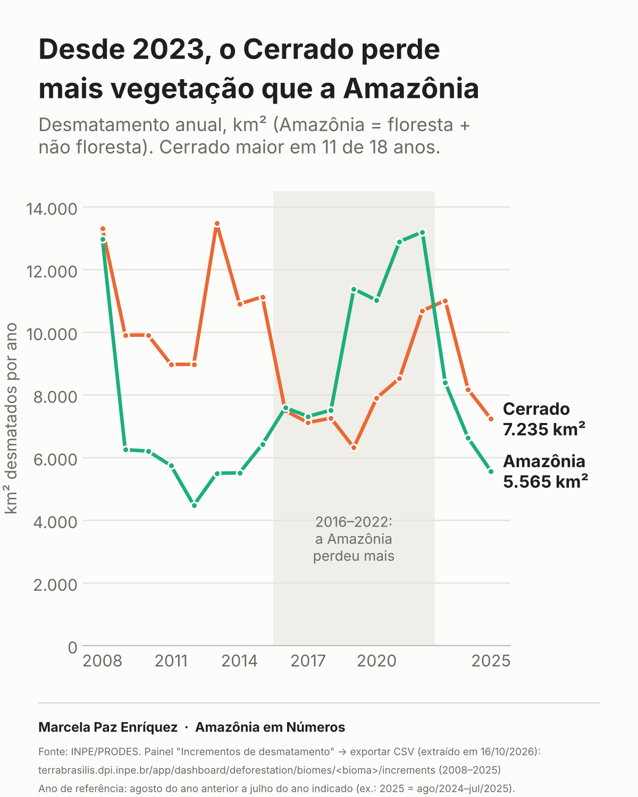
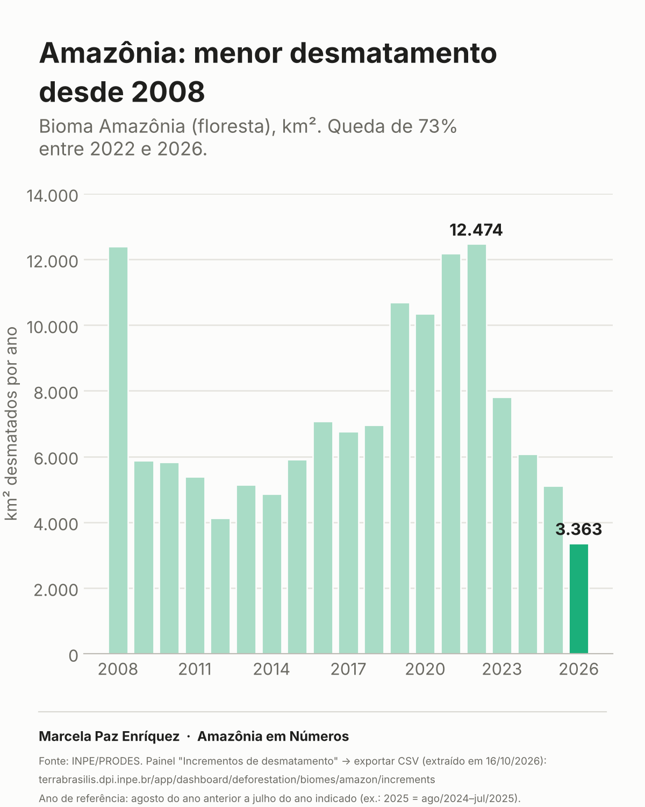
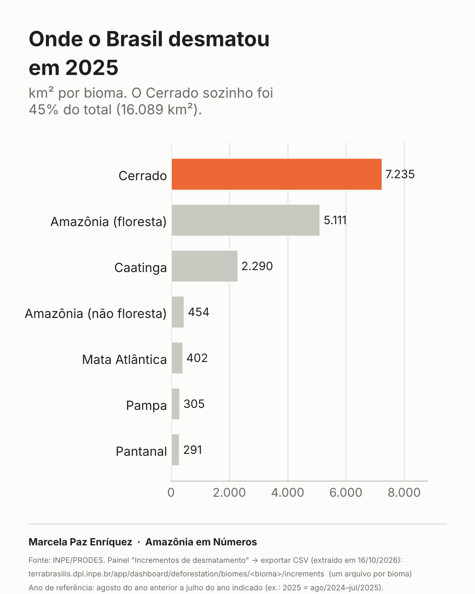

# Amazônia em Números

Dados abertos da série **Amazônia em Números**, publicada no LinkedIn e no Instagram por **Marcela Paz da Silva Enriquez**, economista paraense e mestranda em Ciências Econômicas (UFF), com foco em finanças verdes e desenvolvimento sustentável.

Todos os números vêm **direto da fonte oficial**, com o dado bruto, o script de tratamento e os gráficos, para qualquer pessoa conferir e reproduzir.

---

## #1. Desde 2023, o Cerrado perde mais vegetação que a Amazônia



Na rota Rio–Belém, o avião cruza o Cerrado de Goiás e do Tocantins antes de chegar à floresta. A série do PRODES/INPE (2008–2026) mostra:

- Comparando toda a vegetação nativa (na Amazônia, floresta + não floresta), o Cerrado teve mais área desmatada em **11 dos 18 anos** entre 2008 e 2025. A Amazônia perdeu mais entre 2016 e 2022; desde 2023, o Cerrado voltou a liderar.
- Na floresta do bioma Amazônia, o desmatamento caiu de **12.474 km² (2022)** para **3.363 km² (2026)**, queda de 73% e menor valor desde 2008. O dado de 2026 pode ser preliminar.
- Em 2025, o Cerrado respondeu por **45%** da área desmatada no país (7.235 de 16.089 km²).
- Entre 2008 e 2025, o Cerrado perdeu **168.339 km²** de vegetação nativa, contra 144.598 km² no bioma Amazônia.

<p>
  
  
</p>

---

## Estrutura

```
dados/
  brutos/prodes_<bioma>.csv   ← exportados do TerraBrasilis, sem alteração
  prodes_biomas.csv           ← base tratada (bioma, ano, área, variação)
R/
  prodes_biomas.R             ← trata os brutos e gera os gráficos
graficos/                     ← PNGs 4:5 usados nos posts
posts/                        ← texto de cada post publicado
```

Para reproduzir: abra o RStudio na pasta do repositório e rode `R/prodes_biomas.R`.

## Notas metodológicas

- **Fonte:** INPE/PRODES, painel de incrementos de desmatamento por bioma no [TerraBrasilis](https://terrabrasilis.dpi.inpe.br/app/dashboard/deforestation/biomes/amazon/increments), acesso em 16/10/2026.
- **Ano PRODES:** vai de agosto do ano anterior a julho do ano indicado (2026 = ago/2025 a jul/2026).
- **Bioma Amazônia ≠ Amazônia Legal.** Aqui o recorte é o bioma, separado em floresta e não floresta. A taxa da Amazônia Legal, mais citada na imprensa, inclui áreas de Cerrado e por isso é maior.
- **Mapeamento bienal:** nos primeiros anos, Cerrado, Caatinga, Mata Atlântica, Pampa e Pantanal foram mapeados a cada dois anos, e o valor aparece dividido igualmente entre os dois anos. Esses casos estão marcados na coluna `mapeamento_bienal` e não têm variação anual calculada.
- **Comparabilidade Amazônia × Cerrado:** o PRODES Cerrado mede a supressão de toda a vegetação nativa (savanas, campos e florestas). Por isso, na comparação, a Amazônia soma as séries de floresta e não floresta. Usar só a floresta subestima a Amazônia e infla a vantagem do Cerrado.
- **2026:** só Amazônia (floresta) e Cerrado já têm valor de 2026 no painel, e a série de não floresta termina em 2025. Por isso a comparação vai até 2025. Confira no TerraBrasilis se os números de 2026 ainda são preliminares.
- **Variação anual:** não é calculada em anos de mapeamento bienal nem no ano seguinte a eles.

## Posts da série

| # | Tema | Link |
|---|---|---|
| 1 | [Desde 2023, o Cerrado perde mais vegetação que a Amazônia](posts/01_cerrado_no_caminho_para_belem.md) | _(link do post)_ |

---

Dados públicos, organizados para fins educativos. Ao reutilizar, cite o INPE/PRODES como fonte.
Sugestões ou correções: abra uma *issue*.
